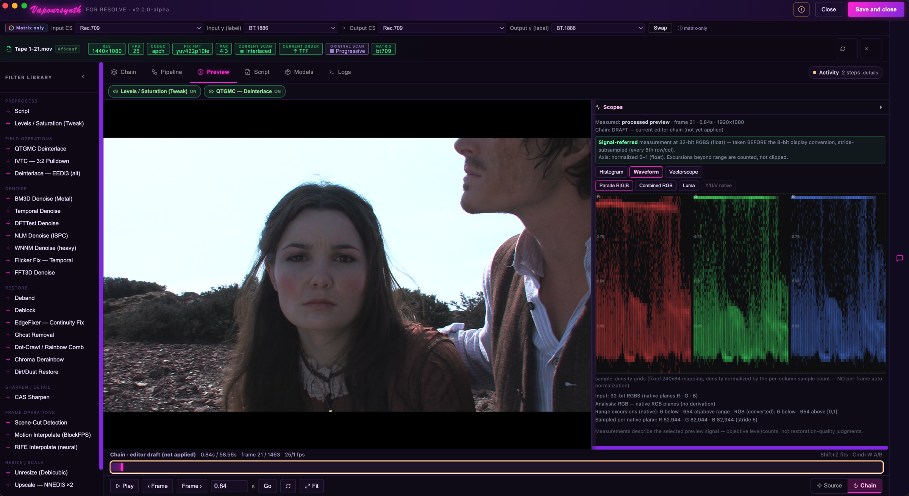
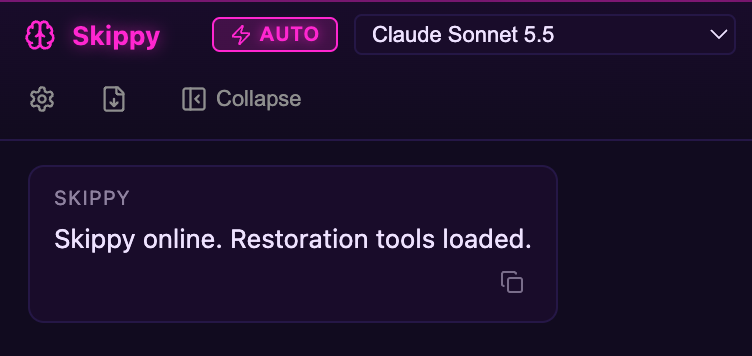
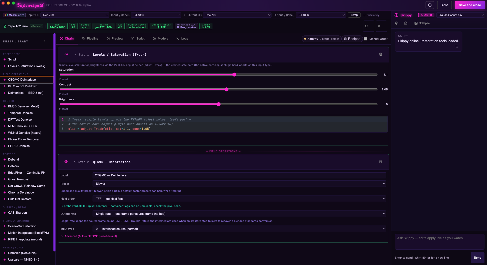
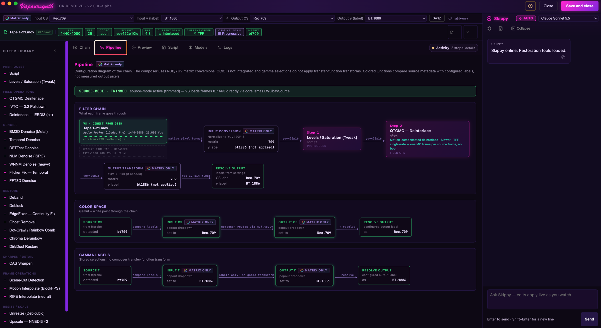
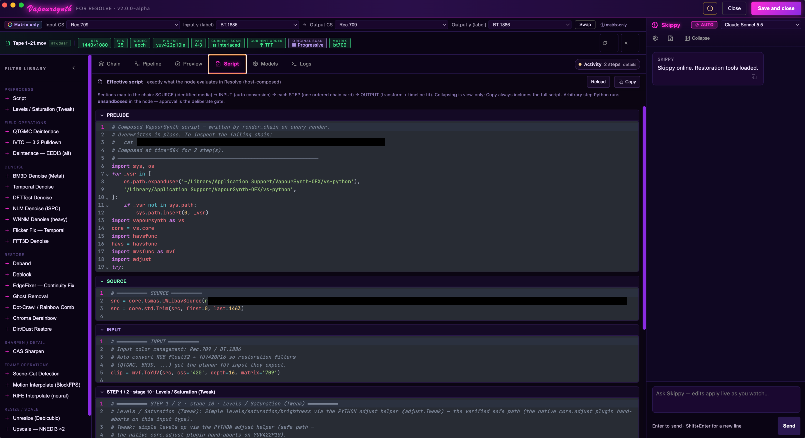

<h1 align="center">VapourSynth for Resolve</h1>

<p align="center">
  VapourSynth restoration filters on a node in DaVinci Resolve.<br>
  Build your filter chain visually, with a built-in assistant to guide you.
</p>

<h3 align="center">
  <a href="https://github.com/Hank-tha-Cowdog/VapourSynth4Resolve/releases/download/v2.0.0-beta.2/VapourSynth.Companion-2.0.0-beta.2-arm64.dmg">Download for macOS</a> <sup>beta</sup>
</h3>

<p align="center">
  <sub>Apple Silicon &nbsp;·&nbsp; macOS 26 or later &nbsp;·&nbsp; DaVinci Resolve 21 &nbsp;·&nbsp; free and open source</sub>
</p>

<p align="center">
  <a href="#skippy-your-restoration-assistant">Meet Skippy</a>
  &nbsp;·&nbsp;
  <a href="#under-the-hood">Under the hood</a>
  &nbsp;·&nbsp;
  <a href="#install">Install</a>
  &nbsp;·&nbsp;
  <a href="#use">Use</a>
  &nbsp;·&nbsp;
  <a href="#build-from-source">Build from source</a>
</p>



<p align="center">
  <sub>The Preview tab: the processed frame beside scopes measured from the same signal.</sub>
</p>

## What it is

[VapourSynth](https://www.vapoursynth.com) is a video processing framework with some of the best restoration filters there are: QTGMC deinterlacing, BM3D denoising and many more. Normally, using it means writing Python scripts.

VapourSynth for Resolve puts those filters on a node in Resolve's Color page. It is made for beginners as much as for experienced restoration artists. It has three parts:

- **The OFX plugin** runs your filter chain inside Resolve.
- **The companion app** is where you build the chain. Pick filters from a library, adjust them, preview the result, then send it back to the node.
- **Skippy** is the assistant built into the app. Ask it what your footage needs, what a filter does, or to write a custom step for you.

There is nothing else to set up. Python, VapourSynth and a curated set of filter plugins are built in.

## Skippy, your restoration assistant

<p align="center">
  
</p>

You do not need to know VapourSynth to use this. Skippy is a chat assistant that sits beside your chain in every tab. It knows video restoration, and it answers in plain language.

Skippy can see your clip's details, such as its format, frame rate and whether it is interlaced, along with the steps already in your chain, so its advice fits your footage. It cannot see the picture itself, so tell it what you see.

**If you are new to restoration,** describe the problem and ask what to do:

- "Moving edges look like the teeth of a comb. What is that, and how do I fix it?"
- "Which denoiser should I start with for a grainy 16mm scan?"
- "What does the QTGMC preset actually change?"

**If you know your way around,** hand it the custom work:

- "Write a step that hides the head-switching noise on this VHS capture."
- "This script step fails. Here is the error."
- "Change this denoise step so it keeps more of the grain."

### An example

You type:

> This VHS capture has a band of flickering noise along the bottom edge. Can you hide it?

Skippy explains what the problem is and adds a step like this to your chain, with comments on each line:

```python
# VHS decks switch heads near the bottom of the picture, which leaves a band
# of torn, flickering lines. Cut those 8 lines off...
clip = core.std.Crop(clip, bottom=8)

# ...then add 8 black lines back, so the frame keeps its size and the rest
# of the chain sees the same resolution. 4096 is video black at 16 bits.
clip = core.std.AddBorders(clip, bottom=8, color=[4096, 32768, 32768])
```

The step arrives unapproved, so nothing runs until you have read it. Click **Approve**, then check the result in **Preview**. If it is not right, say so ("make it 12 lines") and Skippy updates the same step.

### Setting it up

Skippy needs an AI model to talk to. Click the gear in the Skippy panel and add your own API key (Anthropic, OpenAI, Google Gemini, OpenRouter or xAI), or point it at a local model running in LM Studio or Ollama. Cloud providers charge for usage under your own account. Keys are stored in the macOS Keychain.

With a model that supports tool use, Skippy edits the chain directly. With one that does not, it answers with code that you paste into a Script step yourself. See [provider settings](docs/llm-providers.md).

Skippy is optional. Everything else works without it.

## A quick tour

### Chain

Add filters from the library and set them with ordinary controls. Steps are arranged in a sensible restoration order for you, and every step shows the script it produces.



### Pipeline

The whole path on one page: source, input conversion, each filter in order, and the output back to Resolve, with color space and gamma labels at every stage.



### Script

The exact VapourSynth script the node runs, section by section. Nothing is hidden.



## Under the hood

For readers who know VapourSynth, this is what the beta runs:

- **VapourSynth R79** and its own Python, both embedded in the plugin.
- **QTGMC as a built-in step.** It has its own panel with preset, field order, output rate and input type, plus advanced controls for sharpening, source matching and noise handling. Underneath it calls havsfunc's QTGMC, with mvtools and nnedi3 bundled.
- **BM3D denoising on the GPU.** BM3D runs through Apple's Metal. In our test on a 1440×1080 ProRes clip it was about 3.5 times faster than the CPU version. Decoding and most other filters run on the CPU for now. See the [measurements](docs/acceleration-notes.md).

**GPU VapourSynth is next.** VapourSynth added GPU support to its core in R80, and R82 already builds in this repository. The beta stays on R79 because R80 dropped the older plugin interface that many of the bundled filters still use. The move to R82 follows once those filters are updated. See the [upgrade notes](docs/vs-r82-upgrade-2026-11-12.md).

## Install

You need an Apple Silicon Mac on macOS 26 or later, and DaVinci Resolve 21.

1. **Download** [VapourSynth for Resolve for macOS](https://github.com/Hank-tha-Cowdog/VapourSynth4Resolve/releases/download/v2.0.0-beta.2/VapourSynth.Companion-2.0.0-beta.2-arm64.dmg). It is a `.dmg` file and lands in your Downloads folder.
2. **Open the `.dmg`** and drag VapourSynth Companion onto the Applications folder.
3. **Open the app** from Applications. macOS asks you to confirm the first time; click **Open**.
4. **Add the plugin to Resolve.** Quit Resolve first. In the app, click the status icon in the title bar, then click **Install for Resolve**. macOS may ask for your password.
5. **Start Resolve.** VapourSynth is now in the OpenFX library on the Color page.

To update, install the new version of the app the same way, then click **Update for Resolve** in the same place. Older versions are on the [releases page](https://github.com/Hank-tha-Cowdog/VapourSynth4Resolve/releases).

## Use

1. On the **Color** page, open **OpenFX**, find **VapourSynth** and drag it onto a node.
2. In the node's settings, click **Configure…** The companion app opens on that clip.
3. In **Chain**, add filters from the library and adjust them. Not sure where to start? Ask Skippy.
4. In **Preview**, switch between **Source** and **Chain** and read the scopes.
5. Click **Save and close**. The chain is applied to the node and Resolve renders it.

To change the chain later, click **Configure…** again.

A few things worth knowing:

- **Mix** on the node blends the filtered result with the original.
- **Manual Order** lets you arrange the steps yourself instead of using the automatic order.
- **Recipes** saves a chain so you can reuse it on other clips.
- **Render queue** encodes a node's chain to a ProRes 422 HQ or FFV1 file from the app, without rendering in Resolve.
- **Source file.** Restoration filters work best when they read the original media file. If the app does not pick it up by itself, click **Identify source…** or drop the file in from Finder.
- **Script steps run real Python on your Mac.** They only run once you approve them, so read a script before you approve it, including anything a recipe or Skippy proposes.

## Build from source

You need Xcode, Homebrew (for `zimg` and Python 3.12 or later), CMake 3.24 or later, and Node 24.

```sh
scripts/build-vapoursynth.sh R79
cmake -S . -B build -DCMAKE_BUILD_TYPE=Release -DVSRES_VS_PREFIX="$PWD/vendor/vapoursynth/active"
cmake --build build
cd companion-app && npm ci && npm run build
```

This builds the plugin and the app for development. Making the self-contained bundle and the DMG is covered in [packaging](docs/packaging.md). See also [building on macOS](docs/building-macos.md) and [architecture](docs/architecture.md).

## Status

This is a beta.

- It runs on macOS with Apple Silicon only. Windows and Linux are planned.
- It has not been widely tested on other people's Macs yet, so expect rough edges.
- Try it on test projects and copies of your media first.

What changed and what is still open are in the release notes for [beta.2](docs/release-notes-2.0.0-beta.2.md) and [beta.1](docs/release-notes-2.0.0-beta.1.md). Found a bug? [Open an issue](https://github.com/Hank-tha-Cowdog/VapourSynth4Resolve/issues) with your macOS and Resolve versions and the steps to reproduce it. Please leave out private footage and API keys. To help with the code, see [contributing](CONTRIBUTING.md).

## License

The OFX plugin is [GPLv3](LICENSE). The companion app is [MIT](companion-app/LICENSE). Bundled third-party components keep their own licenses; see the [notices index](docs/notices-index.md) and [SBOM](docs/SBOM.md).

## Credits

This project began as a tool for the restoration of Bruce Lee's *Game of Death*. [Read the story](https://zacharymakes.com/projects/vapoursynth-davinci-plugin).

Thanks to **Xappio Inc.** for their contributions and support in this release.

- VapourSynth and the original Windows OFX plugin: Fredrik Mellbin and contributors
- v2 and the companion app: Hank-tha-Cowdog
- Companion shell: VapourSage
- OpenFX: Academy Software Foundation and contributors
- BM3DMETAL: Sunflower-Dolls
- vs-mlrt: AmusementClub
- Every filter, helper and runtime author keeps their own credits and notices
